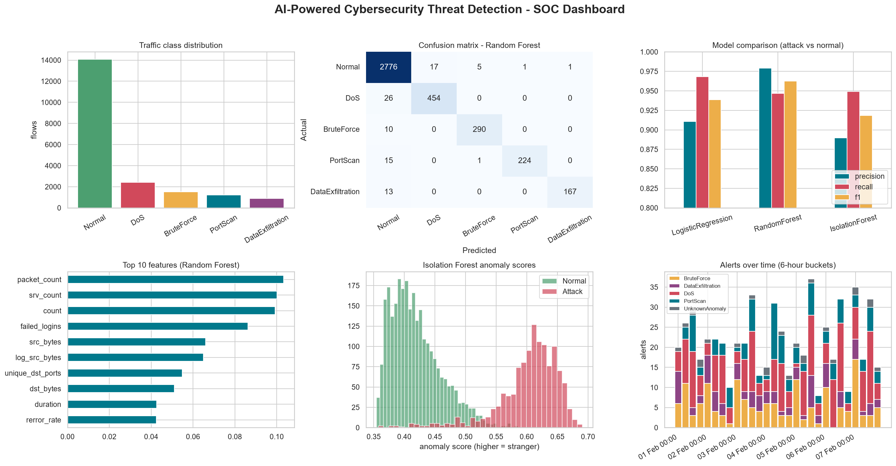
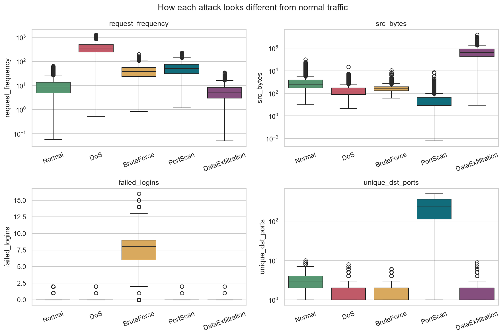
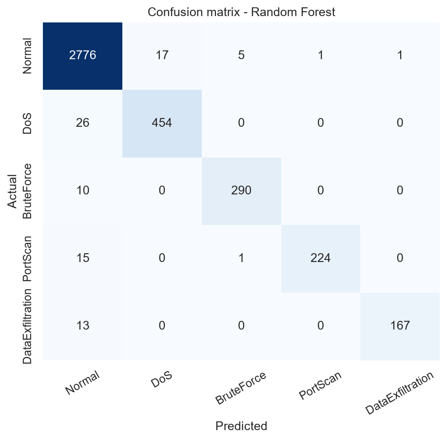
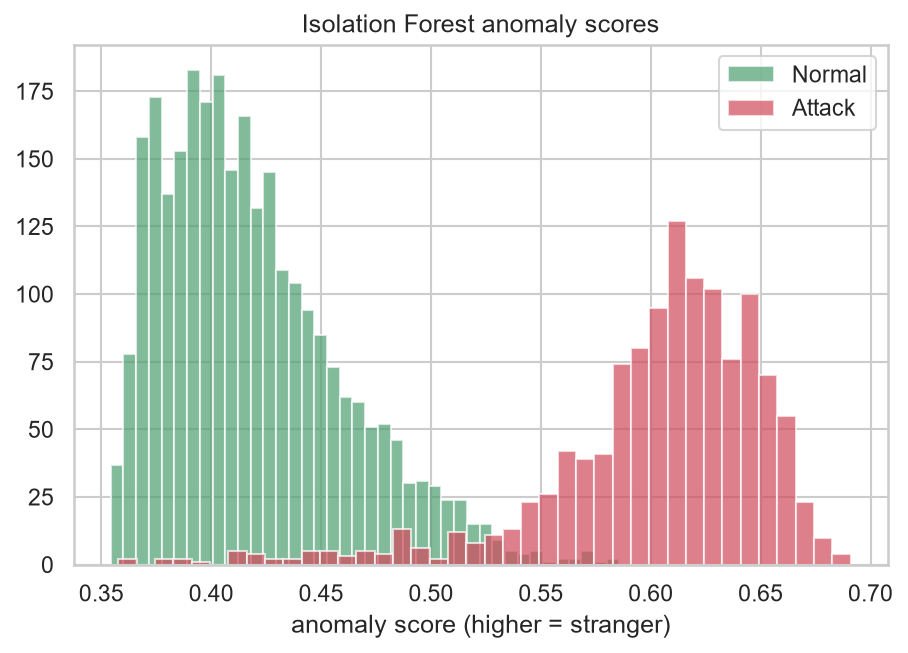
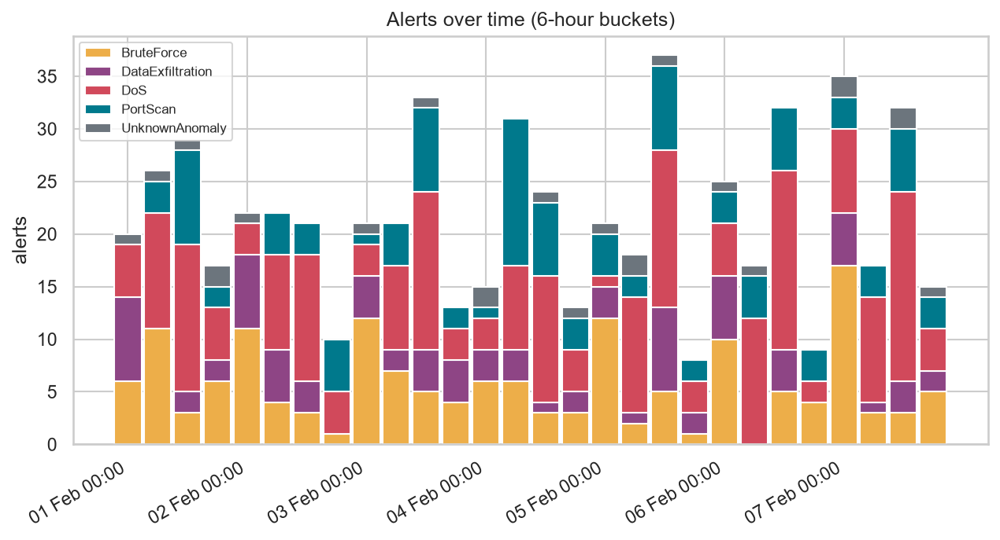

# 🛡️ AI-Powered Cybersecurity Threat Detection

A machine-learning system that analyses network traffic, **classifies attacks** (DoS, brute force, port scan, data exfiltration), **flags unknown anomalies**, and **raises SOC-style alerts with severity and an explanation** — plus a REST API for real-time prediction.



## 📌 Problem Statement
Rule-based security tools (static signatures, fixed thresholds) miss new and subtle attacks and drown analysts in false alarms. This project uses ML to learn what *normal* traffic looks like and what each attack looks like, so threats are detected automatically and prioritised for analysts.

## 🏭 Industry Relevance
The same idea powers Intrusion Detection Systems (IDS), SIEM/SOC platforms, bank fraud monitoring and cloud security tools (e.g. Microsoft Defender, Google Chronicle, IBM QRadar, Palo Alto Cortex). This repo is a small, transparent version of that pipeline.

## 🧰 Tech Stack
Python 3.10+ · pandas · NumPy · scikit-learn (Random Forest, Logistic Regression, Isolation Forest) · Matplotlib · Seaborn · Flask · pytest

## 🗂️ Dataset (virtual simulation)
No real corporate network is needed. `src/data_simulator.py` generates flow-level records in the style of **NSL-KDD / CICIDS2017 / UNSW-NB15**:

| Class | Fingerprint |
|---|---|
| Normal | moderate bytes/packets, successful sessions, low error rates |
| DoS | very high request rate, many half-open (SYN) connections |
| BruteForce | many failed logins on ssh/ftp/telnet |
| PortScan | tiny packets to hundreds of different ports, many rejects |
| DataExfiltration | huge outbound transfer, long duration, often at night |

20,000 training flows (30% attacks), ~1% missing values, duplicates, and ~6% "stealthy" attacks that look normal — so results are realistic, not a fake 100%. You can also train on your own CSV: `python main.py train --data your.csv` (same column names + `attack_type`).

## 🏗️ Architecture
```
Network traffic ─► Cleaning ─► Feature engineering ─► ┌ Random Forest ──► attack type + confidence ┐
(simulated flows)   (dedupe)   (ratios, night flag)    └ Isolation Forest ► anomaly score (zero-day)┘
                                                                  │
                                         Alert engine (severity + reason) ─► alerts.csv/json/log
                                                                  │
                                              Dashboard charts      REST API (/predict)
```
More detail: [docs/ARCHITECTURE.md](docs/ARCHITECTURE.md)

## ⚙️ Installation
```bash
git clone https://github.com/<your-username>/AI-Cybersecurity-Threat-Detection.git
cd AI-Cybersecurity-Threat-Detection
python -m venv venv
venv\Scripts\activate          # Windows   |   source venv/bin/activate  (Mac/Linux)
pip install -r requirements.txt
```

## ▶️ How to Run
```bash
python main.py all         # simulate data → train → detect → charts (≈30 seconds)

# or step by step
python main.py simulate    # creates data/network_traffic.csv and data/live_traffic.csv
python main.py train       # trains + evaluates 3 models, saves to models/
python main.py detect      # scans unseen traffic, prints alerts, saves outputs/alerts.*
python main.py visualize   # creates 10 charts in images/
python main.py serve       # REST API on http://127.0.0.1:5000
```

Test the API:
```bash
curl -X POST http://127.0.0.1:5000/predict -H "Content-Type: application/json" \
     -d '{"packet_size": 1500, "failed_logins": 9, "request_frequency": 250, "service": "ssh"}'
```
```json
{"Threat_Detected": true, "threat_type": "BruteForce", "confidence": 0.86, "severity": "High", "anomaly_score": 0.59}
```
Any field you leave out gets a safe default. Run tests with `python -m pytest -q`.

## 📊 Results
Test set (4,000 flows the model never saw during training), **attack vs normal**:

| Model | Accuracy | Precision | Recall | F1 |
|---|---|---|---|---|
| Logistic Regression (baseline) | 96.2% | 91.1% | 96.8% | 93.9% |
| **Random Forest (main)** | **98.0%** | **99.8%** | 93.6% | **96.6%** |
| Isolation Forest (unsupervised) | 95.0% | 89.0% | 94.9% | 91.9% |

Detection demo on 3,000 *new* flows (600 real attacks): **564 detected (94.0% recall)**, 23 false alarms, 587 alerts. Sample alerts:
```
[CRITICAL] ALERT-00001 DataExfiltration 203.0.113.41 -> 10.0.1.31 conf=0.98 | 0.69 MB sent out over 86s (hour 0)
[HIGH    ] ALERT-00002 DoS              203.0.113.13 -> 10.0.3.3  conf=1.00 | request rate 314/s, SYN-error rate 0.83
[HIGH    ] ALERT-00005 BruteForce       203.0.113.21 -> 10.0.0.1  conf=1.00 | 11 failed logins on ftp
```
Numbers come from simulated data; real-world traffic is harder, so expect lower scores on real datasets.

## 🖼️ Screenshots
| Attack fingerprints | Confusion matrix |
|---|---|
|  |  |

| Anomaly scores | Alert timeline |
|---|---|
|  |  |

## 📁 Project Structure
```
├── main.py              # CLI: simulate / train / detect / visualize / serve / all
├── src/
│   ├── config.py        # paths, columns, labels
│   ├── data_simulator.py# virtual cyber-attack traffic generator
│   ├── preprocessing.py # loading + cleaning
│   ├── features.py      # feature engineering + sklearn preprocessing pipeline
│   ├── train.py         # trains Logistic Regression, Random Forest, Isolation Forest
│   ├── evaluate.py      # accuracy / precision / recall / F1 / confusion matrix
│   ├── detect.py        # threat logic, severity, explanations, alerts
│   ├── visualize.py     # charts + SOC dashboard
│   └── app.py           # Flask REST API
├── tests/               # pytest tests
├── data/ models/ outputs/ images/ docs/ notebooks/
```

## 🎓 Learning Outcomes
End-to-end ML workflow · handling imbalanced, messy data · feature engineering for security · supervised vs unsupervised detection · precision/recall trade-offs for security · alert prioritisation · deploying a model as an API · testing and documenting a project.

## 🚀 Future Improvements
Train on real NSL-KDD / CICIDS2017 · live packet capture · SIEM integration · deep learning (autoencoders) · Streamlit dashboard · Docker.

## 📜 License
MIT — for educational use. All traffic is simulated; no real systems were attacked.
